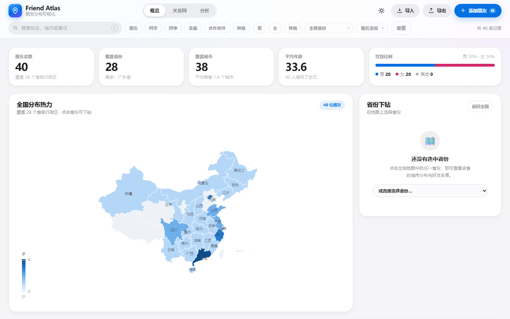

# Friend Atlas · 朋友分布可视化

一个**本地优先**的社交数据可视化 Demo：把「朋友都在哪儿」这件事，变成一张可下钻的中国地图、一张关系网络图和一组可解释的分析图表。零构建、零后端、零 API Key，打开即用。



> 所有人物均为虚构示例数据，仅用于演示。数据只保存在浏览器 `localStorage`，不会上传任何服务器。

---

## 它解决什么问题

散落在聊天记录、通讯录和记忆里的朋友信息，很难回答三个具体问题：**人集中在哪些省市？关系结构长什么样？这群人的画像是什么？**

Friend Atlas 用一套轻量的记录结构（姓名 / 性别 / 生日 / 省·市 / 关系 / 备注）承载这些信息，并提供三个视角：

- **地图**：全国热力分布，点击省份下钻到城市层级
- **关系网**：以「我」为中心、按关系类型着色的力导向图谱
- **分析**：年龄结构、关系构成、城市 TOP 8、省份分布

## 在线 Demo

**https://266sqs778.github.io/friend-atlas/**

本地预览（ES Module 需要 HTTP 协议，不能直接双击 `index.html`）：

```bash
git clone https://github.com/266sqs778/friend-atlas.git
cd friend-atlas
python -m http.server 8080     # 或 npx serve .
# 打开 http://localhost:8080
```

## 功能

| 模块 | 能力 |
| --- | --- |
| 地图 | 中国省级热力着色、悬停查看省市好友明细、点击省份下钻、返回全国、地图缩放拖拽 |
| 省份下钻 | 城市人数条形图、好友姓名 chips、点击 chips 直接编辑；同时提供下拉选择，键盘/无鼠标场景也能用 |
| 关系网 | 力导向图（我 → 关系类型 → 好友）、图例筛选式配色、拖拽与缩放、关系构成排行 |
| 分析 | 年龄区间柱状图、关系环形图、城市 / 省份排行条形图，全部随筛选联动 |
| 数据管理 | 新增 · 编辑 · 删除（可撤销）· CSV / JSON 导入（表头别名、逐行校验、去重）· CSV / JSON 导出 |
| 筛选 | 关键词（姓名 / 城市 / 关系 / 备注）+ 性别多选 + 关系多选 + 省份 + 排序，计数实时反馈 |
| 体验 | 浅色 / 深色外观、响应式（桌面 → 平板 → 手机）、骨架屏、Toast、空状态引导、键盘快捷键 |
| 可访问性 | 跳转链接、`role=tablist/radiogroup/dialog`、焦点陷阱与归还、`aria-live` 播报、可见焦点环、`prefers-reduced-motion` / `prefers-contrast` 适配 |

快捷键：`/` 聚焦搜索，`N` 新增朋友，`T` 切换外观，`Esc` 关闭面板或退出下钻。

## 技术栈

- **原生 HTML / CSS / JavaScript（ES Modules）**：无框架、无构建、无 `node_modules`，克隆即运行
- **Apache ECharts 5.4.3**（本地 vendor，不走 CDN，离线也稳定）
- **中国省级 GeoJSON**（本地 vendor，主源 + 备用源双通道）
- **localStorage** 作为唯一持久层；`File API` + `Blob` 完成纯前端导入导出
- **Node 内置能力**跑单元测试（无第三方测试框架），GitHub Actions 做 CI

## 工程与架构

完整模块划分、数据流与设计取舍见 [docs/ARCHITECTURE.md](docs/ARCHITECTURE.md)。核心特点：

```text
src/
├── data/        # 省市字典、虚构示例数据（纯数据）
├── lib/         # 纯函数层：model / csv / stats / filters / format / storage / theme / dom
├── features/    # 视图与交互：地图、关系网、分析、名录、下钻、筛选、表单、导入、浮层
└── main.js      # 组合根：状态、单向渲染、事件绑定
```

- **单向数据流**：`state → filter/sort → 纯函数聚合 → 各视图 update()`，视图不直接改数据
- **纯函数可测**：统计、筛选、CSV 解析、日期年龄计算、本地存储全部与 DOM 解耦
- **按需重绘**：只有当前页签的图表会被更新；主题切换时销毁并重建 ECharts 实例，避免残影
- **数据自愈**：本地数据损坏、地图数据加载失败、localStorage 被禁用时都有降级路径与明确提示

## 测试与 CI

同一套用例（39 条）可在两种环境运行，共用 `tests/suite.js` 与零依赖断言器：

```bash
node tests/run.mjs                 # Node 20，CI 使用同一命令
# 或浏览器打开 tests/index.html
```

覆盖：日期与年龄边界（闰年、未来生日）、CSV 引号/换行/表头别名/脏行跳过、JSON 备份、统计聚合、多维筛选与排序、本地存储的播种/持久化/损坏回退/禁用降级。

CI：`.github/workflows/ci.yml`，push 与 PR 时自动执行 `node tests/run.mjs`。

## 设计策略

视觉与交互按 Apple Human Interface Guidelines 的八条原则落地（详见架构文档）：

- **Purpose**：一屏三视图，围绕「分布 / 关系 / 画像」三个真实问题组织
- **Agency**：删除可撤销、筛选可重置、面板可 `Esc` 退出，不把人锁进流程
- **Responsibility**：本地优先、首次进入即说明数据去向、示例数据明确标注虚构
- **Familiarity**：分段控件、材料化顶栏、卡片与列表、系统字体栈
- **Flexibility**：浅/深外观、三档断点、键盘与指针双通道、减少动效与高对比偏好
- **Simplicity**：一屏之内完成查看—筛选—编辑，不引入多级导航
- **Craft**：统一的设计令牌（字号、圆角、阴影、动效曲线），数字使用等宽数字
- **Delight**：克制的位移与弹性动画、骨架屏到真实内容的平滑衔接

## 数据与隐私

- 不请求任何后端接口做数据读写，唯一网络请求是可选的地图 GeoJSON 备用源
- 导入文件在浏览器内解析，不会上传
- `localStorage` 键名：`friend-atlas.collection.v1`、`friend-atlas.theme`；清空数据即删除记录
- 仓库内所有姓名、生日、备注均为虚构

## 已知边界

- 单机单浏览器数据，无多端同步（这是本地优先的取舍，不是缺陷）
- 地图为省级粒度，城市级展示以榜单与下钻面板呈现
- 关系网适合数十到数百节点；更大规模需要换用聚合或分层渲染

## License

[MIT](LICENSE)
